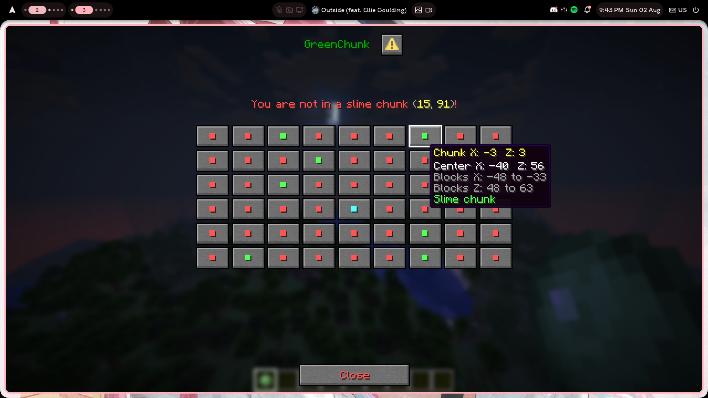
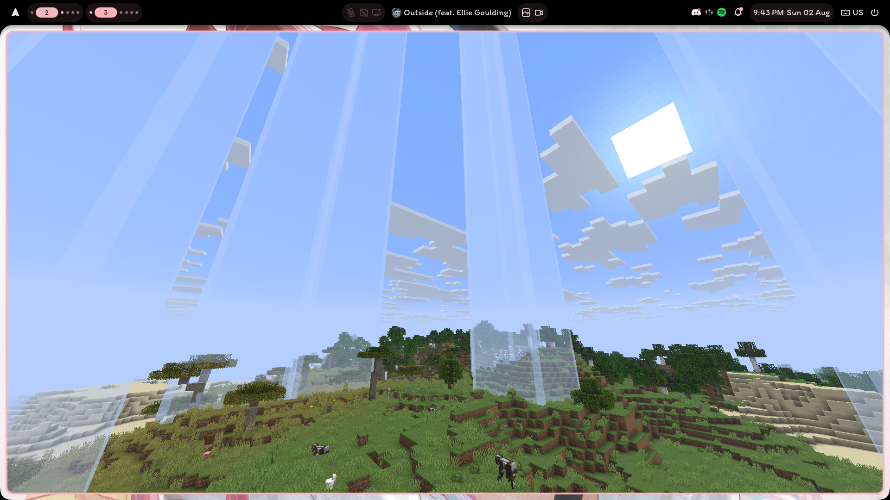

GreenChunk 2.0.0-1 — Folia / Shiroha 26.2 maintenance fork.

Based on [MidnightTale/GreenChunk](https://github.com/MidnightTale/GreenChunk),
commit `f12de3d788f5f1fe4594247544bdded2d8a455ab` (MIT). Requires Java 25.
Built from upstream source; no classes from third-party production JARs are reused.

Shows slime chunks with dialog UI or as a private 3D in-world display.

Use a slime ball by default:

- right-click to toggle the in-world display
- sneak + right-click to open the map

Commands: `/slime` reports the current chunk in chat; `/slimemap` opens the dialog;
`/slimevisual` toggles the private overlay. `/greenchunkreload` (alias `/slimereload`)
reloads settings and refreshes active overlays.

Settings and messages are in `plugins/GreenChunk/config.yml`. Run
`/greenchunkreload` after editing it.

Permissions: `greenchunk.map`, `greenchunk.visual`, `greenchunk.item.map`, and
`greenchunk.reload`. `/slime` uses `greenchunk.check`. Legacy permission
`greenchunk.map.item` remains a parent of `greenchunk.item.map`, including explicit denials.

Upgrade from 1.4: stop the server, back up the plugin folder, remove the old
GreenChunk JAR and install the release JAR. Start normally; do not use `/reload`
or a plugin hot loader. The first start backs up legacy `config.yml` as
`config-v1-backup.yml`, migrates item settings and legacy messages/colors/coordinates,
and adds missing defaults with comments. Explicit modern settings and unrelated
keys are retained. In particular, `enableSlimeMapItem: false` becomes
`item.enabled: false`; commands remain available. The old inventory map is now a dialog.

Chunk checks use the server's `Chunk.isSlimeChunk()` on its region scheduler,
including custom slime seeds, all-slime overrides and Shiroha SecureSeed.
Queries asynchronously load/generate the bounded map area (up to 100 chunks for
the map, 81 for the overlay). Each player has one pending query per feature;
the service caps actual in-flight backend work at 1024 even after a caller times out.
Player UI and display creation run on the player scheduler; display removal runs
on each display's scheduler. Stale results after movement, world change, quit,
reload or toggle are discarded. Overlays are non-persistent and cleaned on quit;
hot disabling the plugin while the server continues running is not supported.

Build with JDK 25: `./gradlew clean check jar sourcesJar` (Windows: `gradlew.bat`).
The Folia API version is pinned. To compile against an exact server's extracted
libraries instead, pass `-PserverLibraries=/absolute/path/to/libraries` (include
JetBrains annotations for compilation). No server libraries are shaded into the plugin.
`check` runs regression tests and scans the built JAR for the known injected-loader markers.
The optional `integration/probe` is for isolated testing only and is not bundled in releases.
